# Parakh Architecture & Technical Design Specification

> **Prove Your Skills. Back Every Claim.**  
> Parakh is an open-source, evidence-grounded developer capability assessment platform. It bridges the trust gap between software engineers and engineering hiring teams by evaluating public GitHub repositories against client opportunity briefs using strict deterministic code citations, commit pinning, and conservative scoring rules.

---

## Table of Contents
1. [Core Architectural Philosophy](#1-core-architectural-philosophy)
2. [General System Architecture Diagrams](#2-general-system-architecture-diagrams)
   - [2.1 End-to-End System & Monorepo Topology](#21-end-to-end-system--monorepo-topology)
   - [2.2 Capability Assessment & Citation Verification Pipeline](#22-capability-assessment--citation-verification-pipeline)
   - [2.3 Defense-in-Depth Security & Privacy Architecture](#23-defense-in-depth-security--privacy-architecture)
3. [Sponsor Integration Architecture Diagrams](#3-sponsor-integration-architecture-diagrams)
   - [3.1 Google AI Studio & Google Gemma (Core Reasoning LLM)](#31-google-ai-studio--google-gemma-core-reasoning-llm)
   - [3.2 MongoDB Atlas (Document Store & Automated TTL Lifecycle)](#32-mongodb-atlas-document-store--automated-ttl-lifecycle)
   - [3.3 Sentry (Agent Tracing & Privacy-Preserving Observability)](#33-sentry-agent-tracing--privacy-preserving-observability)
   - [3.4 ElevenLabs (Multimodal Audio & Executive Briefings)](#34-elevenlabs-multimodal-audio--executive-briefings)
   - [3.5 Render (Cloud Infrastructure & Automated IaC Deployments)](#35-render-cloud-infrastructure--automated-iac-deployments)
   - [3.6 Typed Agent Workflows (Mastra Architectural Pattern)](#36-typed-agent-workflows-mastra-architectural-pattern)
   - [3.7 GitHub Copilot (AI-Assisted Pair Programming Workflow)](#37-github-copilot-ai-assisted-pair-programming-workflow)
   - [3.8 Secondary & Boundary Integrations (Isolation Architecture)](#38-secondary--boundary-integrations-isolation-architecture)
4. [Source Code Linkages & Verification Matrix](#4-source-code-linkages--verification-matrix)

---

## 1. Core Architectural Philosophy

Parakh is designed around three strict non-negotiable principles:

1. **Deterministic Grounding Over Generative Hallucination:**  
   LLMs are strictly confined to structured extraction and candidate ranking. Every capability assertion must be backed by a deterministic code citation (`filePath`, `startLine`, `endLine`) validated against the immutable commit tree. If an LLM cites nonexistent files or hallucinated line numbers, the validator strictly rejects it and flags the requirement as `Needs Review`.
2. **Conservative Status Scoring:**  
   - **Demonstrated:** Valid code citation with test evidence in the target repo.
   - **Partially Demonstrated:** Code exists, but automated tests or documentation are absent.
   - **Needs Review:** Disputed or unverifiable claims.
   - **Not Demonstrated in Supplied Evidence:** Transparent admission that the skill is not demonstrated in the analyzed repository.
3. **Strict Boundary Isolation for External Services:**  
   The core capability assessment engine operates 100% independently. If secondary providers (voice synthesis, external memory, or third-party search) experience downtime or missing keys, the core assessment completes without disruption.

---

## 2. General System Architecture Diagrams

### 2.1 End-to-End System & Monorepo Topology

This diagram illustrates the full application layout across monorepo packages, frontend SPA, backend services, and cloud integrations.

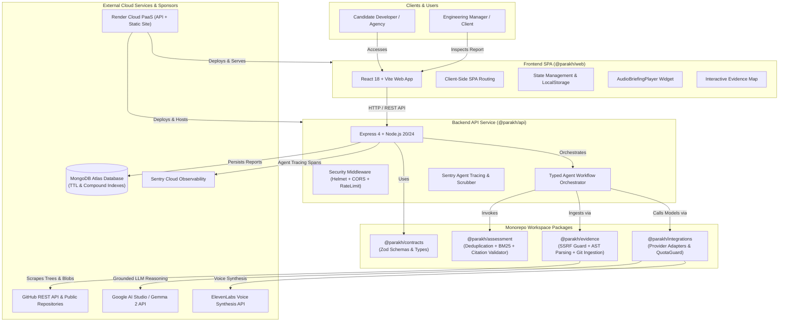

---

### 2.2 Capability Assessment & Citation Verification Pipeline

This flowchart documents the 6-stage lifecycle from raw brief ingestion to cryptographic sealing and persistent storage.

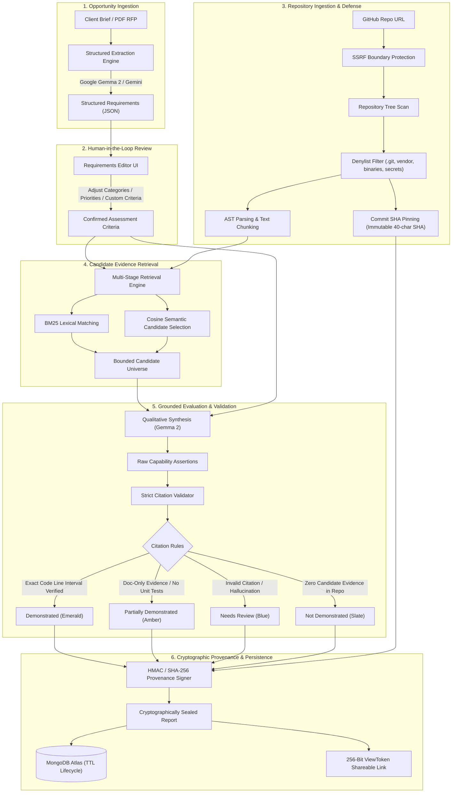

---

### 2.3 Defense-in-Depth Security & Privacy Architecture

This diagram illustrates the perimeter defense, data minimization, and secret scrubbing safeguards applied across every layer.

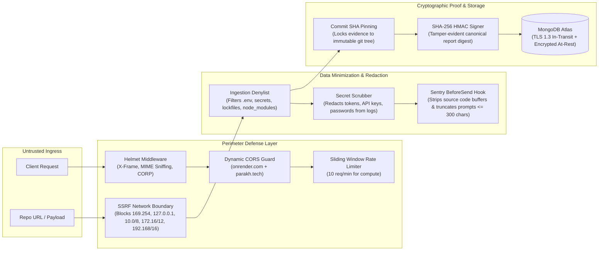

---

## 3. Sponsor Integration Architecture Diagrams

---

### 3.1 Google AI Studio & Google Gemma (Core Reasoning LLM)

- **Role:** Powers structured requirement extraction from raw text/PDFs and qualitative capability synthesis.
- **Architectural Guardrails:** Temperature clamped to `0.1` to prevent hallucinations, `QuotaGuard` implements leaky-bucket rate limiting (15 RPM cap with 800ms spacing and randomized jitter).
- **Model Adaptability:** Defaults to `gemini-3.8-flash` via Google AI Studio API (`responseMimeType: "application/json"`). Natively supports open-weights Gemma models (`gemma-2-9b-it`, `gemma-2-27b-it`) by cleanly omitting the `responseMimeType` parameter to avoid HTTP 400 parameter errors.

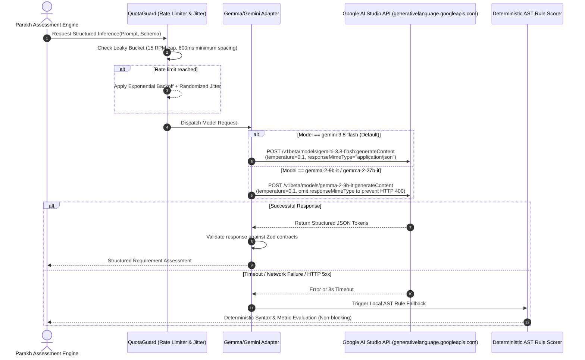

---

### 3.2 MongoDB Atlas (Document Store & Automated TTL Lifecycle)

- **Role:** Primary cloud persistence for assessment reports with native TTL document lifecycle management, compound query indexing, and TLS 1.3 encryption.
- **Resilience:** Implements automatic URI sanitization (stripping quotes and accidental prefixes) and includes an active health probe (`GET /api/health/mongodb`) validating cipher suites and round-trip ping latency.

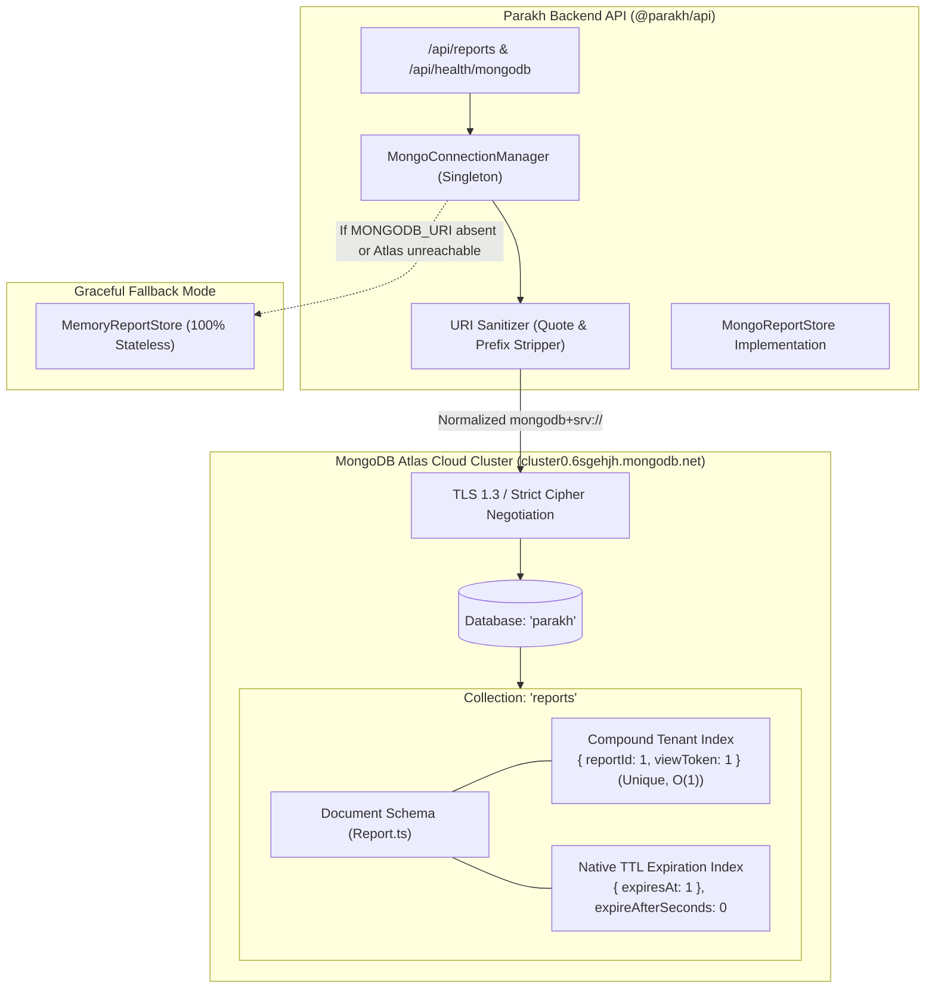

---

### 3.3 Sentry (Agent Tracing & Privacy-Preserving Observability)

- **Role:** End-to-end distributed agent tracing instrumented directly across every step of the assessment workflow.
- **Data Minimization:** `sentryBeforeSend` redacts repository source buffers and truncates LLM prompts to 300 characters, guaranteeing zero candidate code or credential leakage to third-party telemetry.

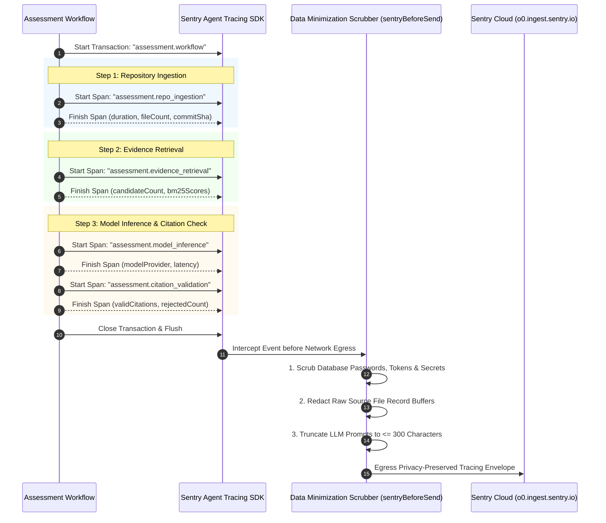

---

### 3.4 ElevenLabs (Multimodal Audio & Executive Briefings)

- **Role:** Converts verified assessment summaries into synthesized audio briefings for mobile dashboards and recruiter reviews.
- **Isolation:** Operates via authenticated `POST /api/reports/:id/audio` with viewToken verification, strict 800-character budgeting, and graceful degradation if the API key is not configured.

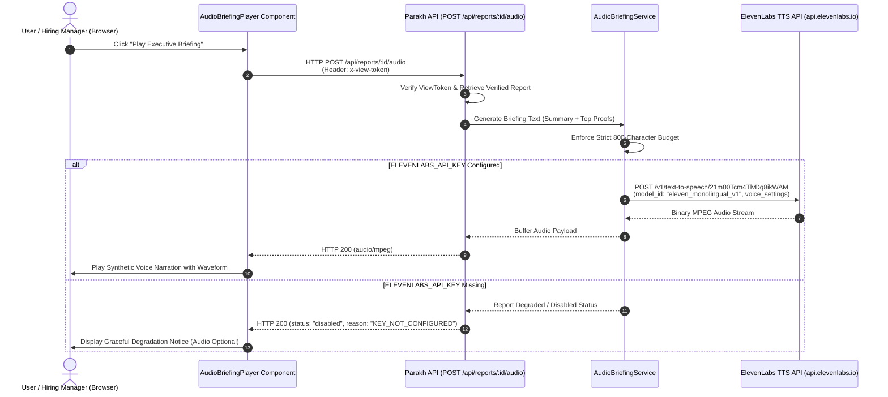

---

### 3.5 Render (Cloud Infrastructure & Automated IaC Deployments)

- **Role:** Continuous deployment and multi-service orchestration configured via `render.yaml` Infrastructure as Code.
- **Topology:** Web service `parakh-api` hosting the Node.js API with health checks, coupled with static site `parakh-web` hosting the React Vite SPA. Includes automated hostname resolution (`normalizeApiBaseUrl()`) mapping bare slugs to fully qualified `.onrender.com` domains.

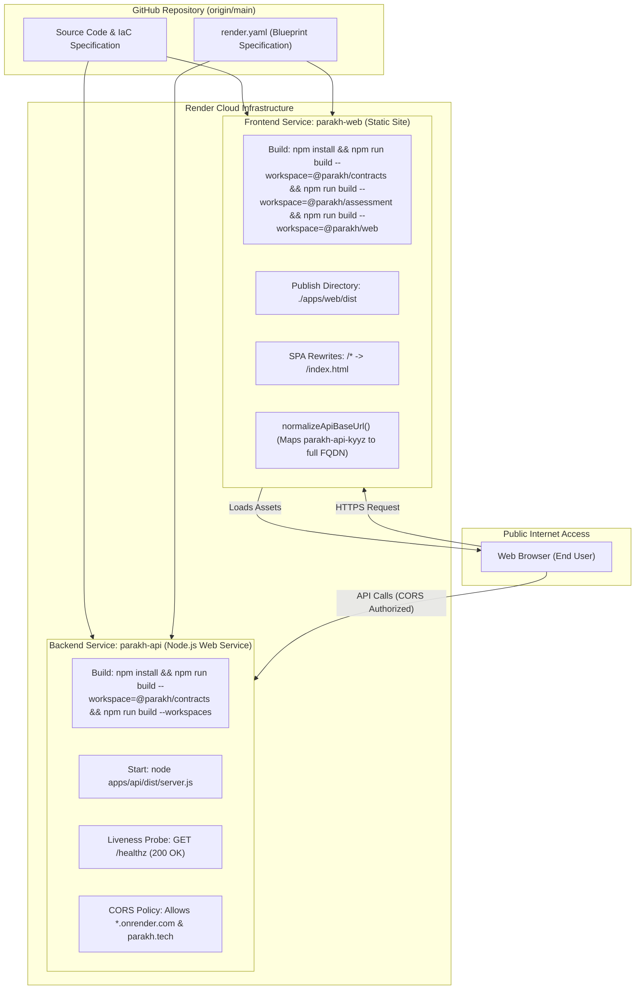

---

### 3.6 Typed Agent Workflows (Mastra Architectural Pattern)

- **Role:** Coordinates multi-phase candidate evaluation through typed step contracts and isolated execution boundaries.
- **Pattern:** Native TypeScript implementation inspired by Mastra architecture, ensuring type safety between extraction, retrieval, reasoning, and citation validation without external runtime dependencies.

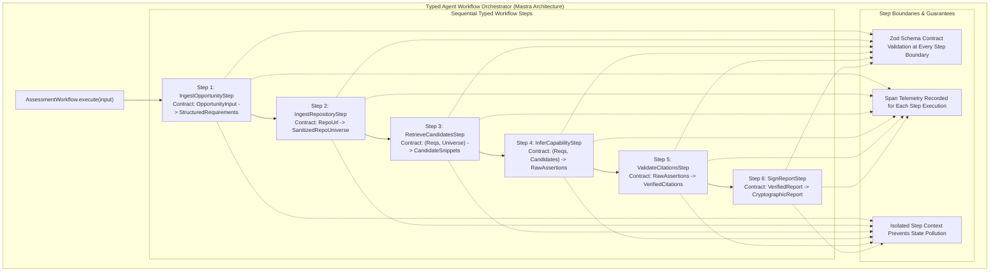

---

### 3.7 GitHub Copilot (AI-Assisted Pair Programming Workflow)

- **Role:** AI-assisted development workflow used during hackathon development to accelerate AST traversal logic, Zod schema contracts, and adversarial test suites.
- **Transparency:** All AI-assisted components were subjected to human-in-the-loop review, strict type checking, and automated test gates (documented in `docs/copilot-usage.md`).

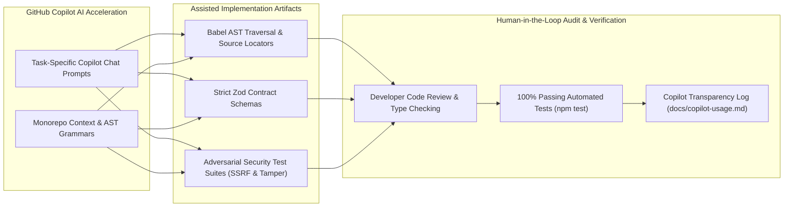

---

### 3.8 Secondary & Boundary Integrations (Isolation Architecture)

- **Role:** Manages exploratory sponsor prototypes and non-track integrations behind strict non-blocking feature flags (`getSecondaryFeatureFlags()`).
- **Evidence Integrity Guarantee:** Exploratory adapters (such as SerpApi external documentation search) are strictly isolated with `isCandidateEvidence: false` to ensure external web results can never contaminate cryptographic candidate repository evidence.

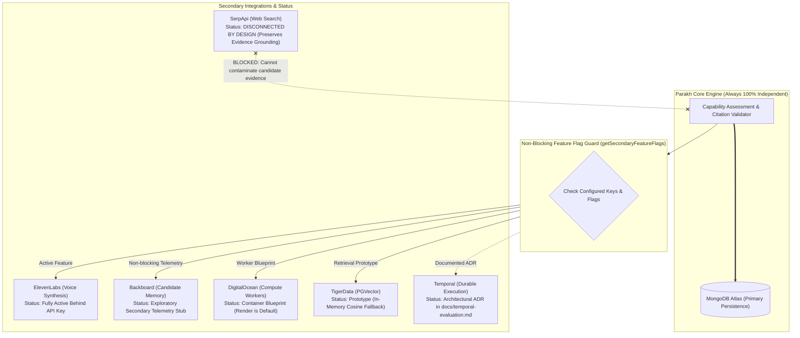

---

## 4. Source Code Linkages & Verification Matrix

| Architecture Component | Primary Implementation Files | Verification Test Command | Status |
|:---|:---|:---|:---:|
| **Google AI Studio & Gemma** | [`packages/integrations/src/gemma/`](file:///packages/integrations/src/gemma/) | `npx tsx --test packages/integrations/src/gemma/adapter.test.ts` | **Verified Active** |
| **MongoDB Atlas** | [`apps/api/src/storage/`](file:///apps/api/src/storage/) | `npx tsx --test tests/integration/mongoLifecycleProvenance.test.ts` | **Verified Active** |
| **Sentry Agent Tracing** | [`apps/api/src/observability/`](file:///apps/api/src/observability/) | `npx tsx --test apps/api/src/observability/sentry.test.ts` | **Verified Active** |
| **ElevenLabs Audio** | [`apps/api/src/services/audioBriefingService.ts`](file:///apps/api/src/services/audioBriefingService.ts) | `npx tsx --test tests/integration/audioBriefing.test.ts` | **Verified Active** |
| **Render Cloud IaC** | [`render.yaml`](file:///render.yaml) | `curl -s https://parakh-api-kyyz.onrender.com/healthz` | **Verified Live** |
| **Mastra Pattern** | [`apps/api/src/mastra/`](file:///apps/api/src/mastra/) | `npx tsx --test apps/api/src/mastra/workflows/assessmentWorkflow.test.ts` | **Verified Active** |
| **SSRF & Security Shield** | [`packages/evidence/src/ingestion.ts`](file:///packages/evidence/src/ingestion.ts) | `npx tsx --test tests/security/ssrfSecurity.test.ts` | **Verified Active** |
| **Citation Validator** | [`packages/assessment/src/validator.ts`](file:///packages/assessment/src/validator.ts) | `npx tsx --test tests/unit/citationValidator.test.ts` | **Verified Active** |
| **Cryptographic Provenance** | [`apps/api/src/services/provenance.ts`](file:///apps/api/src/services/provenance.ts) | `npx tsx --test tests/security/tamperEvidence.test.ts` | **Verified Active** |

