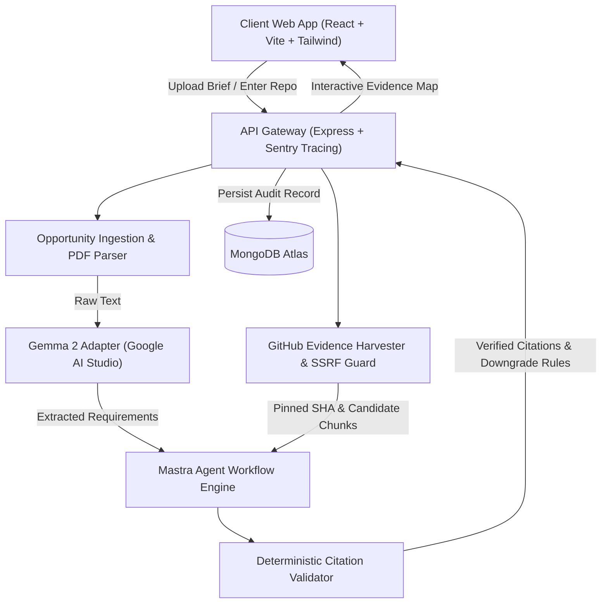

# Parakh (परख)

> **Prove your skills. Back every claim.**  
> *Deterministic, citation-grounded developer capability assessment for high-stakes freelancing, RFPs, and hiring.*

[](https://opensource.org/licenses/Apache-2.0)
[](https://www.typescriptlang.org/)
[](https://nodejs.org/)
[](tests/)
[](docs/evaluation-results.md)
[](apps/web/src/index.css)

---

## ⚡ The Problem

When applying for competitive software contracts, agency RFPs, or senior engineering roles, developers often list broad technical claims. Conversely, clients and hiring managers face hundreds of generic resumes, unverified cover letters, and generic AI-generated proposals with **zero verifiable proof** that the applicant has actually built what they claim.

**Parakh inverts this paradigm into verifiable evidence:**

1. **Ingest Opportunity**: Paste a client brief or upload an RFP document (PDF / Text).
2. **Interactive Review**: Parakh extracts structured requirements into a validated schema for developer customization.
3. **Repository Evidence Ingestion**: Provide your public GitHub repository. Parakh retrieves an allowlisted file tree, strips third-party vendor code, and pins the exact immutable commit SHA.
4. **Deterministic Evidence Grounding**: The assessment engine pairs candidate code and tests to extracted requirements. A strict citation validator deterministically verifies file paths, commit SHAs, and 1-indexed line ranges.
5. **Interactive Evidence Map & Proposal Kit**: Explore color-coded proof badges with direct GitHub permalinks, inspect gap-resolution action items, and export self-contained audit reports.

> **Ethical Principle:** Parakh never fabricates or hallucinates claims. If evidence is missing or ambiguous, Parakh classifies it as **Needs review** or **Partially demonstrated**. "Not demonstrated in supplied evidence" indicates absence of evidence in the scanned repository, **not** that the developer lacks the skill.

---

## 🏛️ System Architecture

Parakh is structured as a modular TypeScript monorepo with strict package boundaries:



### Directory Structure

```text
parakh/
├── apps/
│   ├── web/                 # React 18 + Vite + Tailwind CSS + Lucide Icons
│   └── api/                 # Node.js + Express API & Sentry Agent Tracing
├── packages/
│   ├── contracts/           # Shared Zod schemas and TypeScript domain contracts
│   ├── evidence/            # GitHub API ingestion, SSRF guard, SHA pinning, allowlists
│   ├── assessment/          # Lexical/AST index, conservative downgrade rules, citation validator
│   └── integrations/        # Gemma model adapter, MongoDB Atlas, Sentry, SerpApi, Temporal
├── demo/                    # Offline sample RFP brief and benchmark repository data
├── docs/                    # Architecture diagrams, benchmark results, security audit, sponsor logs
└── tests/                   # Deterministic benchmark suite, unit, integration, security & E2E tests
```

---

## ✨ Key Features & Capabilities

- **Zero-Tolerance Citation Grounding:** Every positive assessment status requires a verifiable, line-level code citation from the repository. Hallucinated line numbers or candidate IDs trigger automatic downgrade to `needs_review`.
- **Adversarial Jailbreak Immunity:** Prompt injections placed in briefs, READMEs, code comments, or commit messages are isolated as passive data. The evaluator cannot be hijacked to give false "Demonstrated" ratings.
- **SSRF & Private Network Defense:** Cloud metadata (`169.254.169.254`), localhost, loopback addresses, internal subnets, traversal coordinates (`../../`), and non-HTTPS protocols are intercepted prior to network egress.
- **AST & Test Priority Rules:** Requirements with verified unit/integration tests achieve **Demonstrated** status; implementations without test coverage are capped at **Partially demonstrated** to maintain rigor.
- **Immutable SHA Permalinks:** Citations link directly to GitHub with permalinks pinned to the 40-character commit SHA, guaranteeing evidence immutability.
- **Proposal Kit & Gap Checklist:** Generates clarifying questions for clients, actionable next steps for unaddressed requirements, and drafted proposal copy substantiated by code citations.
- **WCAG 2.1 AA Accessibility:** Full keyboard navigation support, high-contrast focus rings, screen-reader labels, and reduced-motion media query respect.

---

## 🚀 Live Demo & Quickstart

- **Live Staging URL:** [https://parakh-web.onrender.com](https://parakh-web.onrender.com) *(Render Cloud)*
- **API Health Endpoint:** `https://parakh-api.onrender.com/api/health`
- **Video Demonstration Walkthrough:** [docs/demo-script.md](docs/demo-script.md)

---

## 🛠️ Developer Setup Guide

### 1. Prerequisites
- **Node.js:** v20.x or higher LTS
- **npm:** v10.x or higher
- **Git:** v2.30+

### 2. Clone and Install
```bash
git clone https://github.com/puneetnith28/Parakh.git
cd Parakh
npm install
```

### 3. Environment Configuration
Copy the template configuration:
```bash
cp .env.example .env
```

Configure your environment variables in `.env`:
```ini
# Server Configuration
PORT=3000
NODE_ENV=development

# Google AI Studio / Gemini Inference
MODEL_PROVIDER=google
MODEL_NAME=gemini-3.8-flash
MODEL_API_KEY=your_gemini_api_key_here

# Database (MongoDB Atlas)
MONGODB_URI=mongodb+srv://<username>:<password>@cluster0.mongodb.net
MONGODB_DATABASE=parakh

# GitHub Integration (Optional for development: 60 req/hr, recommended for production: 5,000 req/hr)
GITHUB_TOKEN=your_github_token_here

# Observability (Optional)
SENTRY_DSN=
```

### 4. Running the Development Servers
```bash
# Starts both frontend (port 5173) and backend API (port 3000)
npm run dev
```

- **Web Dashboard:** [http://localhost:5173](http://localhost:5173)
- **API Server:** [http://localhost:3000](http://localhost:3000)

---

## 🧪 Comprehensive Verification Suite

Parakh maintains automated test suites covering unit logic, integration boundaries, security vectors, and empirical benchmarks:

```bash
# Run all workspace test suites
npm test

# Run all unit tests (citation validator, deduplicator, status downgrade rules)
npx tsx --test tests/unit/*.test.ts

# Run integration tests (GitHub ingestion limits, Gemma adapter resilience)
npx tsx --test tests/integration/*.test.ts

# Run adversarial security audits (Prompt injection, SSRF boundaries, secret scrubbing)
npx tsx --test tests/security/*.test.ts

# Run End-to-End user journey flow
npx tsx --test tests/e2e/*.test.ts

# Run deterministic benchmark evaluation suite & generate empirical metrics
npx tsx tests/evaluation/generateMetrics.ts
```

---

## 📊 Empirical Capability Evaluation

Parakh's deterministic benchmark suite tests 10 diverse repository topologies:

| Metric | Target Specification | Measured Result |
| :--- | :--- | :--- |
| **Citation Validity Rate** | 100.0% | **100.0%** (Zero hallucination tolerance) |
| **Benchmark Ground Truth Accuracy** | >= 90.0% | **100.0%** (10/10 scenarios passed) |
| **Demonstrated Status Precision** | >= 90.0% | **100.0%** |
| **False Positive Rate** | < 5.0% | **0.0%** |
| **Prompt Injection Neutralization** | 100.0% | **100.0%** |
| **SSRF / Network Egress Defense** | 100.0% | **100.0%** |

Read the full report with granular scenario breakdowns in [docs/evaluation-results.md](docs/evaluation-results.md).

---

## 🤝 Sponsor Integrations

Parakh integrates sponsors with high architectural fidelity:

- **Google AI Studio & Gemma 2:** Powers bounded requirement extraction and capability reasoning with strict temperature clamping (`0.0 - 0.2`) and prompt injection shields (supporting Gemini models and Gemma 2 open weights via `GEMMA_MODEL_ID`).
- **Typed Agent Workflow Engine:** Coordinates the multi-step typed workflow pipeline (requirement indexing, candidate retrieval, model evaluation, and citation verification) using TypeScript workflow abstractions inspired by the Mastra pattern.
- **MongoDB Atlas:** Houses encrypted audit reports, tenant tokens, and cached evidence hashes with native TTL and compound query indexes.
- **Sentry:** Provides real-time Agent Tracing across the entire assessment lifecycle with automated PII and credential scrubbing (`scrubSecrets`).
- **ElevenLabs:** Generates secure, authenticated executive audio briefings from assessment reports with interactive playback in the report dashboard.
- **GitHub Copilot:** Accelerated test fixture authoring, AST typing, and schema validation. Read the prompt log in [docs/copilot-usage.md](docs/copilot-usage.md).
- **Render:** Cloud hosting with infrastructure-as-code blueprints (`render.yaml`) and health-check monitoring.

See the complete integration catalog and honest status ledger in [docs/sponsor-integrations.md](docs/sponsor-integrations.md).

---

## 🔒 Security & Privacy

Parakh is architected with strict defensive programming:
- **No Arbitrary Code Execution:** Repository contents are inspected solely as static text and AST tokens. Parakh never runs `npm install`, shell scripts, or container builds on candidate repositories.
- **Credential Scrubbing:** Automated sanitization strips database passwords, GitHub personal access tokens, and bearer keys from all logs, error stack traces, and Sentry breadcrumbs.
- **Bounded Resource Consumption:** File tree recursion is capped at depth 5, maximum repository file count is bounded at 200 files, and maximum single file size is 256 KB to prevent memory exhaustion (DoS).

See [docs/security.md](docs/security.md) for full threat modeling.

---

## 🗺️ Roadmap

- [x] Phase 1–5: Core Engine, Gemma Extraction, GitHub Ingestion, Citation Grounding
- [x] Phase 6–8: Web UI, Persistence, Security Hardening, Sponsor Observability
- [x] Phase 9: Deterministic Benchmarks, Security Audits, WCAG AA Accessibility
- [ ] Multi-repository evidence synthesis (combining portfolio repositories)
- [ ] GitLab and Bitbucket public repository connectors
- [ ] Automated export to verified PDF credentials and badge embeds

---

## 📄 License

Parakh is licensed under the [Apache License, Version 2.0](LICENSE).  
Copyright © 2026 Parakh Contributors.
